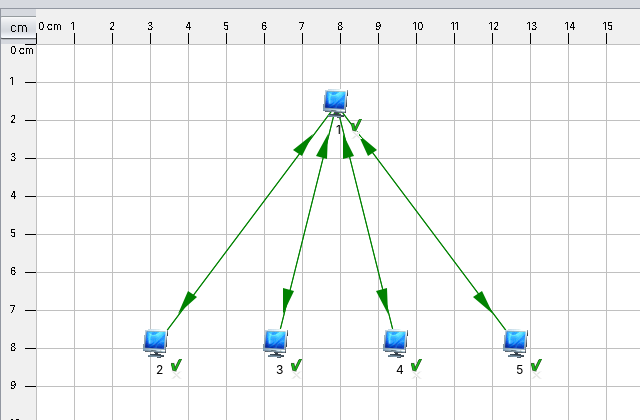
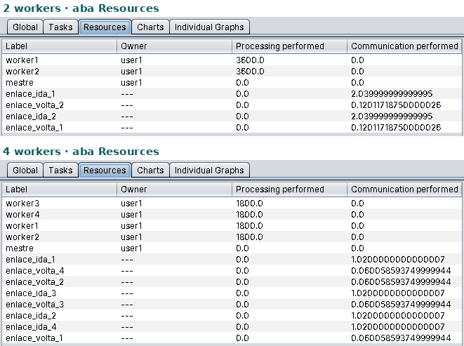

# 1. Vínculo com a solução

No Zela, cada relato de zeladoria passa por um processamento pesado: triagem por um modelo de linguagem, análise da foto por visão computacional e, quando o cidadão pergunta algo, busca e geração de resposta. Na POC o modelo de linguagem roda na própria máquina (sem API paga), e a triagem levou de 24 a 33 s por relato numa CPU de 2 núcleos (`docs/avaliacao_ia.md`). Depois de um temporal, centenas de relatos chegam em pouco tempo. A pergunta deste estudo é prática: **dobrar os workers que processam a fila de relatos de 2 para 4 reduz quanto o tempo para esvaziar essa fila?**

Cada **tarefa** do modelo é o processamento completo de um relato. O **mestre** recebe os relatos e distribui; os **workers** processam.

# 2. Parâmetros (iguais nos dois cenários)

| Parâmetro | Valor | De onde veio |
|---|---|---|
| Carga | 240 tarefas | Hipótese de pico: 240 relatos na hora seguinte a um temporal (4 por minuto) |
| Tamanho de cada tarefa | 300.000 MFlop (fixo) | 30 s de processamento numa máquina de 10 GFlop/s, a média medida na triagem do Zela |
| Comunicação por tarefa | 16 Mbit (2 MB) | Texto do relato mais uma foto comprimida |
| Capacidade de cada máquina | 10.000 MFlop/s | Valor nominal usado para converter o tempo medido em MFlop. O que importa é a razão tamanho/capacidade |
| Rede | enlace próprio mestre-worker, 1.000 Mbit/s, latência 0,001 s | Rede local de datacenter |
| Escalonador | Workqueue | Entrega uma nova tarefa a quem termina primeiro. Serve para tarefas de duração variável, como as respostas de um LLM |
| Única diferença | 2 ou 4 workers | |

O tamanho é fixo para que a diferença entre os cenários venha só do número de workers. A variação de tamanho aparece na análise de sensibilidade (seção 5). Os modelos são gerados por `cluster/gerar_modelos.py` e ficam em `cluster/modelos/` (`principal_2_workers.imsx` e `principal_4_workers.imsx`), prontos para abrir na interface do iSPD.

{width=36%}

# 3. Resultados

| Cenário | Total Simulated Time (s) | Ociosidade de processamento (%) | Ociosidade de comunicação (%) | Processamento por worker (s) |
|---|---|---|---|---|
| 2 workers | **3.602,27** | 0,063 | 99,97 | 3.600 (120 tarefas × 30 s) |
| 4 workers | **1.801,16** | 0,064 | 99,97 | 1.800 (60 tarefas × 30 s) |

- **Redução percentual:** (3.602,27 − 1.801,16) / 3.602,27 = **50,00%**
- **T₂ / T₄:** 3.602,27 / 1.801,16 = **2,00**

{width=100%}

{width=78%}

Os valores variam um pouco entre execuções (3.602,18 a 3.602,27 s), porque o iSPD sorteia pequenas variações internas; em cenários curtos a variação pesa mais. A aba Resources mostra os tempos em segundos: a carga foi dividida igualmente entre os workers, o mestre não processou tarefas e cada enlace de ida ficou ocupado só 2,04 s (2 workers) ou 1,02 s (4 workers).

# 4. Discussão

**Por que o ganho foi exatamente 2.** As 240 tarefas são independentes: nenhum relato precisa do resultado de outro, então não há parte sequencial que limite o ganho (na Lei de Amdahl, fração serial próxima de zero). A rede ficou praticamente parada (99,97% de ociosidade de comunicação): enviar 2 MB por um enlace de 1 Gbit/s leva cerca de 0,02 s, contra 30 s de processamento. O Workqueue manteve os workers ocupados quase o tempo todo (0,06% de ociosidade) e 240 é divisível por 4, então nenhum worker ficou sobrando no final. Esse é o melhor caso possível, e por isso foi adotado de propósito como cenário principal: ele mostra o teto do ganho.

**O que isso significa para o cidadão.** Com 2 workers, o último relato do pico espera cerca de uma hora para ser analisado; com 4, cerca de meia hora. Um ponto importante para a decisão: o processamento total é o mesmo nos dois casos (7.200 s de máquina). Numa nuvem cobrada por segundo, 4 workers durante 30 minutos custam o mesmo que 2 workers durante 1 hora. Ligar workers extras só durante os picos (escalonamento automático) reduz a espera sem aumentar o gasto de processamento, descontado o tempo para as máquinas subirem.

**Limites de extrapolar a simulação para o protótipo.** (1) O tamanho de 300.000 MFlop e os 16 Mbit são hipóteses declaradas, convertidas do tempo medido com uma capacidade nominal; no protótipo, o tempo do LLM varia com o tamanho do relato e da resposta. (2) O iSPD entrega as 240 tarefas no instante zero; na prática os relatos chegam ao longo da hora, e a espera depende da taxa de chegada. (3) Os workers do modelo são idênticos, não falham e não têm custo para ligar; cada worker real precisa de cerca de 4 GB de memória só para carregar o modelo de linguagem. (4) O mestre do modelo apenas distribui; no protótipo, a API e o banco SQLite são compartilhados e podem virar gargalo antes do processamento. (5) A simulação mede tempo, não a qualidade das respostas da IA. Por isso os números servem para comparar configurações, e não para prometer um tempo de atendimento.

# 5. Sensibilidade: quando o ganho deixa de ser 2

Para não tirar conclusões só do melhor caso, a comparação foi repetida mudando uma condição por vez. Dentro de cada par, tudo continua igual exceto o número de workers.

| Cenário | O que muda | T₂ (s) | T₄ (s) | Redução | T₂/T₄ |
|----|----------|---|---|---|---|
| Principal | (nada) | 3.602,21 | 1.801,19 | 50,00% | 2,000 |
| Tarefas variáveis | tamanho sorteado (50 a 600 mil MFlop), média de 30 simulações | 2.252,43 | 1.137,19 | 49,51% | 1,981 |
| Poucas tarefas | 6 relatos (madrugada) | 90,75 | 62,15 | 31,52% | 1,460 |
| Rede compartilhada | vídeo de 12,5 MB por relato, switch de 10 Mbit/s | 4.822,12 | 2.453,89 | 49,11% | 1,965 |

- **Tarefas variáveis.** Quando os relatos têm durações diferentes, o fim da execução depende das últimas tarefas: alguns workers terminam antes e esperam. A ociosidade com 4 workers subiu para 0,9% e o ganho caiu para 1,98. O sorteio do iSPD resultou em tarefas de 18,7 s em média, por isso os tempos absolutos são menores que os do cenário principal; a comparação vale dentro do par.
- **Poucas tarefas.** Com 6 relatos, 2 workers fazem 3 rodadas e 4 workers fazem 2 rodadas, com dois workers parados na segunda (27% de ociosidade). O ganho cai para 1,46 (de 1,41 a 1,49 em cinco execuções). Em horários calmos, mais workers quase não ajudam.
- **Rede compartilhada.** Os workers foram modelados com o ícone de cluster do iSPD, em que todos disputam o mesmo switch. Com 4 workers a rede fica quase saturada (1,2% de ociosidade de comunicação). Com 8 workers, em um teste adicional, o tempo foi de 2.453,85 s, praticamente igual ao de 4. Nesse cenário, dobrar as máquinas de novo não traz ganho nenhum, e o investimento certo passa a ser a rede ou a compressão das mídias.

Para o Zela, a conclusão é: escalar de 2 para 4 workers vale a pena nos picos, porque o trabalho é quase todo paralelo e a rede local sobra. O ganho deixa de compensar em horários calmos e quando o gargalo vira a rede, por exemplo se o cidadão passar a enviar vídeos.

# 6. Como reproduzir

**Pela interface:** `java -jar iSPD.jar` (Java 8+; <https://www.dcce.ibilce.unesp.br/spd/downloads/iSPD.jar>), File > Open, `cluster/modelos/principal_2_workers.imsx`, Simulate; veja as abas Global e Resources. Repita com `principal_4_workers.imsx`.

**Pelo terminal** (todos os cenários): `cd cluster && python gerar_modelos.py && python simular.py --ispd /caminho/iSPD.jar` (em servidor sem tela, instale o `xvfb`). Saídas em `cluster/resultados/` (relatório do iSPD por modelo e `comparacao.csv`); telas em `cluster/capturas/`.
