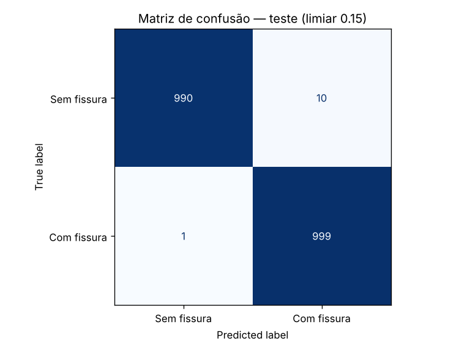
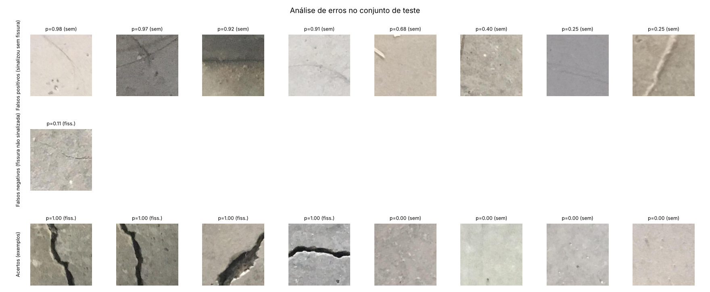
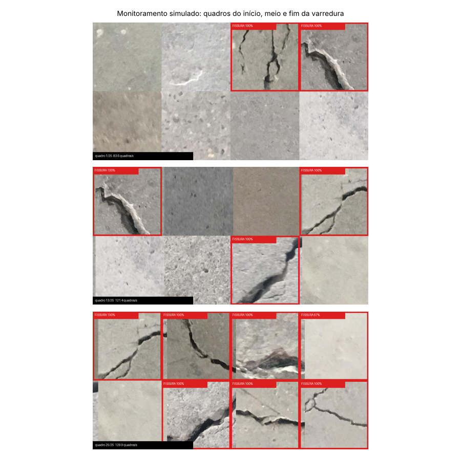

# 1. Problema e vínculo com o Zela

O Zela é uma POC de zeladoria urbana: o cidadão relata um problema, a IA organiza o relato e a equipe da prefeitura trata a solicitação. Muitos relatos envolvem estruturas (muros, viadutos, passarelas, calçadas) em que uma foto diz mais que o texto. O tema escolhido é a **classificação de fissuras em concreto**, ligada ao Zela em dois pontos:

1. **Relato do cidadão.** A foto anexada ao relato é dividida em áreas de 227 px e cada área é classificada. O resultado (quantas áreas têm sinais de fissura e a confiança máxima) entra no prompt da triagem e aparece para o cidadão, com as áreas marcadas sobre a foto. A foto não é guardada.
2. **Monitoramento do gestor.** Uma sequência de fotos de vistoria (câmera veicular, drone ou equipe de campo) é analisada em lote, e as fotos com sinais de fissura sobem para o topo da lista de vistorias. O robô de RPA usa o mesmo modelo nas fotos que as subprefeituras enviam.

Uma regra vale para tudo: **a presença de fissura não determina a gravidade**. O modelo só diz "parece haver fissura aqui"; quem decide se há risco estrutural é o técnico. A interface e a API repetem esse aviso.

# 2. Dados

| Item | Valor |
|---|---|
| Base | Concrete Crack Images for Classification (Özgenel, 2019), a primeira das bases sugeridas no enunciado. Mendeley Data, DOI 10.17632/5y9wdsg2zt (usada a versão 2), licença CC BY 4.0 |
| Conteúdo | 40.000 recortes RGB de 227 × 227 px (20.000 com fissura, 20.000 sem), feitos a partir de 458 fotos de prédios do campus METU |
| Amostra usada | treino 3.000, validação 800, teste 2.000 (metade de cada classe) |
| Divisão | por **blocos de 50 arquivos consecutivos**, 70/15/15% dos blocos por classe, semente 42 |

**Por que dividir por blocos.** Os recortes vêm de poucas fotos grandes, e recortes vizinhos da mesma foto são quase iguais. Se a divisão fosse aleatória por arquivo, o teste teria "irmãos" das imagens de treino e as métricas ficariam infladas. A base não informa de qual foto original veio cada recorte, então a ordem dos arquivos serve de aproximação: recortes com números próximos tendem a vir da mesma foto, e o bloco inteiro vai para um só conjunto. É uma mitigação, não uma garantia; por isso o resultado do teste é tratado como limite superior e foi feito o teste de robustez da seção 5.

Foi usada uma amostra (5.800 das 40.000 imagens) porque o treino roda em CPU de 2 núcleos, sem GPU. Com 7,3 minutos de treino o modelo já satura a validação, então mais dados não mudariam a conclusão nesta base.

# 3. Arquitetura, pré-processamento e treino

| Decisão | Escolha | Justificativa |
|---|---|---|
| Arquitetura | MobileNetV3-Small pré-treinada no ImageNet (torchvision), cabeça trocada para 2 classes | Modelo de 2,5 milhões de parâmetros, feito para rodar em CPU e celular. O Zela roda em servidor gratuito sem GPU, então leveza pesa mais que o último ponto de F1 |
| Entrada | 160 × 160 px, normalização do ImageNet | 160 px mantém a fissura visível e corta o custo pela metade em relação a 224 px |
| Aumento de dados (treino) | recorte aleatório (70–100% da área), espelhamento horizontal e vertical, brilho e contraste ±30% | Fissura não tem orientação, e fotos de cidadão variam muito de luz |
| Treino | 1 época só da cabeça (lr 1e-3), depois 2 épocas da rede inteira (lr 3e-4), AdamW | Transferência de aprendizado em duas fases evita estragar os pesos pré-treinados no início |
| Exportação | ONNX (opset 17), 6,1 MB, inferência com ONNX Runtime | A API não precisa de PyTorch (imagem Docker menor). Diferença máxima entre PyTorch e ONNX: 0,013 na probabilidade |
| Fotos grandes | divisão em blocos de 227 px após reduzir o lado maior para até 1.135 px | O modelo foi treinado com recortes de 227 px; aplicar na foto inteira reduziria a fissura a poucos pixels |

**Limiar de decisão.** Foram testados limiares de 0,10 a 0,90 na validação, e ficou o que maximiza F2 (o recall pesa o dobro da precisão), porque na triagem deixar de sinalizar uma fissura custa mais do que pedir uma vistoria a mais. A validação saturou: F1 = 1,0 de 0,15 a 0,50, então a métrica sozinha não decidiu. O limiar adotado foi **0,15** porque fissuras finas recebem probabilidade baixa (o único falso negativo do teste teve p = 0,11). No teste, esse limiar não trouxe ganho de recall em relação a 0,5 e gerou 5 falsos positivos a mais (tabela abaixo). Se as equipes de vistoria reclamarem de alarmes falsos, 0,5 é a alternativa já medida.

# 4. Resultados no teste (2.000 imagens nunca vistas)

| Limiar | Acurácia | Precisão | Recall | F1 | Falsos positivos | Falsos negativos |
|---|---|---|---|---|---|---|
| 0,50 | 0,997 | 0,995 | 0,999 | 0,997 | 5 | 1 |
| **0,15 (escolhido)** | 0,9945 | 0,990 | 0,999 | 0,9945 | 10 | 1 |

ROC AUC = 1,00. Matrizes de confusão: `visao_computacional/resultados/matriz_confusao_limiar_escolhido.png`.

{width=45%}

**Desempenho (latência e FPS).** Equipamento: Intel Xeon 2,1 GHz, 2 threads, sem GPU, ONNX Runtime 1.29.0.

| Medida | Resultado |
|---|---|
| Inferência por recorte (160 × 160, 200 repetições) | média 1,34 ms; p95 1,85 ms |
| Ponta a ponta por recorte (abrir, redimensionar, normalizar, inferir) a partir de 227 × 227 | 2,02 ms, cerca de 496 imagens/s |
| Monitoramento simulado (quadros de 908 × 454, 8 blocos por quadro) | 9,0 ms por quadro, cerca de 112 quadros/s |
| Endpoint `/visao/analisar` da API, foto de 227 × 227 (1 bloco), 20 chamadas | mediana 4,9 ms (p95 7,5 ms), dos quais 2,2 ms no modelo |
| Endpoint `/visao/analisar`, foto de celular de 12 MP (4032 × 3024, JPEG de 1,5 MB), 20 chamadas | mediana 163 ms (p95 209 ms): decodificar e reduzir a foto para 1135 × 851 pesa mais que os 15 blocos no modelo (58 ms) |

As medições do endpoint foram feitas com a API local na mesma máquina, enquanto outro processo usava a CPU, então são um limite superior. Mesmo assim, uma foto de celular é analisada em menos de 0,25 s, bem abaixo do tempo que o cidadão leva para escrever o relato. O gargalo, nessa escala, é abrir e reduzir a foto, e não o modelo.

# 5. Análise de erros e robustez

{width=100%}

O que os erros mostram:

- **Rótulos duvidosos.** Três dos falsos positivos com probabilidade alta (0,98, 0,97 e 0,91) mostram linhas finas que parecem fissuras capilares. Pode ser erro de rótulo da base, e o modelo pode estar certo. Os rótulos não foram corrigidos, para não mexer no teste depois de ver o resultado.
- **Sombras e juntas.** O falso positivo de 0,92 é a borda de uma sombra ou junta horizontal: uma linha escura reta, que o modelo confunde com fissura.
- **Texturas e marcas.** Riscos claros e manchas (0,25 e 0,68) aparecem com probabilidade média.
- **Fissura muito fina.** O único falso negativo é uma fissura fina sobre textura granulada (p = 0,11).

Para medir o efeito de condições reais, foram aplicadas perturbações em 600 imagens do teste:

| Condição | Precisão | Recall | F1 |
|---|---|---|---|
| Original | 0,997 | 1,000 | 0,9985 |
| Sombra lateral | 0,985 | 1,000 | 0,992 |
| Pouca luz (40%) | 0,991 | 0,997 | 0,994 |
| Superexposição (180%) | 0,976 | 0,994 | 0,985 |
| Desfoque (raio 2) | 0,991 | 0,997 | 0,994 |
| Ruído gaussiano (σ = 25) | 0,997 | 1,000 | 0,9985 |
| Compressão JPEG forte | 0,973 | 0,997 | 0,985 |

Superexposição e compressão forte (comum em fotos enviadas por aplicativos de mensagem) são as condições que mais derrubam a precisão: o modelo passa a ver fissura em textura. O recall se mantém acima de 0,99 em todas.

**Limitações que a métrica alta esconde.** A base tem fundo homogêneo, foco próximo e só concreto. Fotos de cidadão têm obstáculos (pessoas, carros, fios, pichação), perspectiva, vegetação e outros materiais (asfalto, reboco, tijolo). Nessas fotos são esperados mais falsos positivos. O próximo passo é avaliar em outra base, sem treinar nela, por exemplo a SDNET2018 (pontes, muros e pavimentos), e montar um conjunto pequeno de fotos reais de São Paulo rotulado à mão.

# 6. Integração no protótipo

| Onde | Como |
|---|---|
| API | `POST /visao/analisar` (uma foto: classe, probabilidade máxima, áreas sinalizadas, latência, interpretação) e `POST /visao/lote` (até 40 fotos, imagens por segundo; uma foto inválida não derruba o lote). Arquivo inválido, tipo não suportado, foto pequena demais e modelo indisponível têm mensagem própria |
| Front do cidadão | campo opcional de foto no relato; na tela de revisão, a foto aparece com as áreas marcadas e o aviso de que a foto não mede gravidade |
| Triagem | o resumo da foto entra no prompt como contexto do sistema ("sinais de fissura em 3 de 9 áreas... indica inspeção, não gravidade") |
| Gestor | aba "Monitoramento por imagens": lote de fotos, tabela ordenada pela confiança e galeria das fotos para vistoria prioritária |
| RPA | o robô classifica as fotos de vistoria enviadas pelas subprefeituras e registra o resultado no banco de auditoria |
| Sequência / vídeo | `visao_computacional/resultados/monitoramento_simulado.mp4`: 25 quadros de uma câmera passando por um muro, com as áreas sinalizadas |

{width=100%}

# 7. Ética e privacidade

- A foto é processada em memória e descartada: a API não grava imagens, e o relato guarda só o resumo numérico.
- O formulário pede para evitar rostos e placas. Uma evolução necessária para produção é borrar rostos e placas automaticamente antes da análise.
- O modelo não decide nada sozinho: ele prioriza vistorias. A decisão sobre risco é do técnico, o que reduz o dano de um falso negativo e evita alarmar o cidadão com um falso positivo.
- ODS 11 (cidades sustentáveis, meta 11.b de resiliência) e ODS 9 (infraestrutura).

# 8. Como reproduzir

```bash
cd visao_computacional
pip install torch torchvision onnx onnxruntime scikit-learn opencv-python matplotlib pillow
# baixe a base em https://data.mendeley.com/datasets/5y9wdsg2zt/2 e extraia (pastas Positive/ e Negative/)
python pipeline.py --dados /caminho/ConcreteCrack --threads 2
```

Saídas: `modelos/fissura_mobilenetv3s.onnx`, `modelos/preprocessamento.json` (copiados para `backend/app/modelos/`) e tudo de `resultados/`. Testes automatizados da integração: `backend/tests/test_inteligencia.py`.

**Vídeo de demonstração (roteiro sugerido, até 3 min):** (1) relato com foto de muro rachado e a revisão com as áreas marcadas; (2) a mesma foto com sombra forte para mostrar um erro; (3) aba do gestor com um lote de 16 fotos e a ordenação por confiança; (4) o vídeo de monitoramento simulado; (5) fechamento com a limitação de gravidade.
