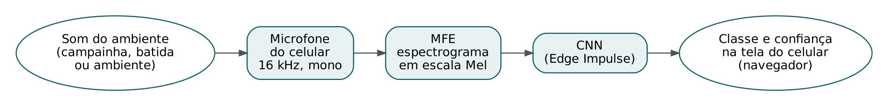
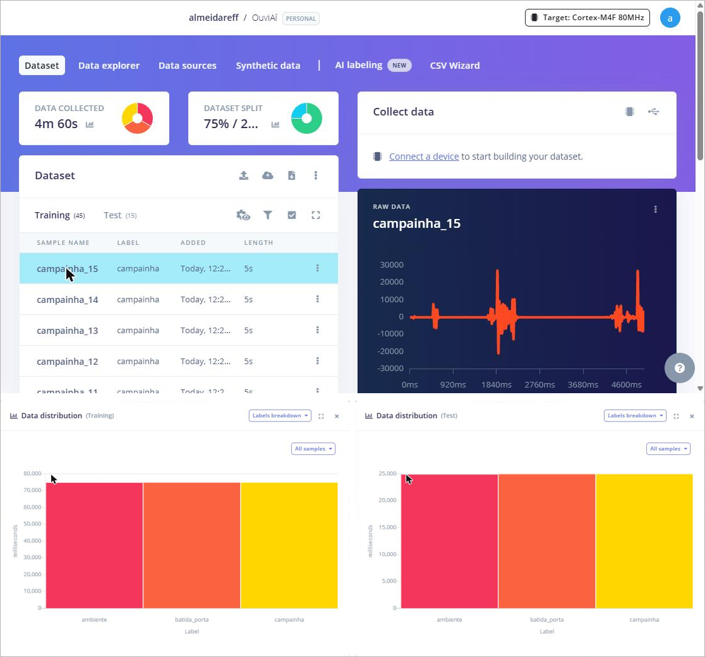
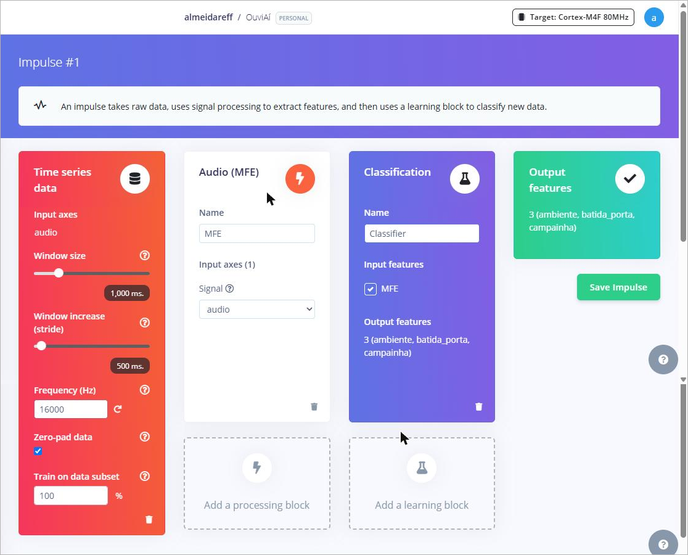
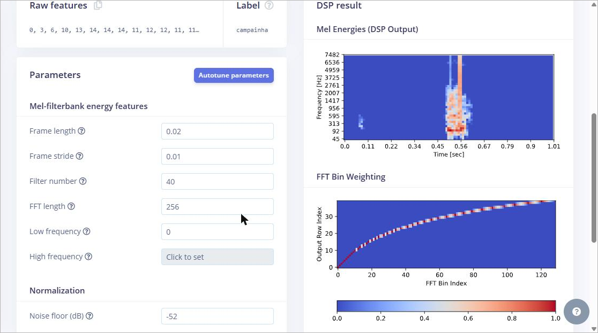
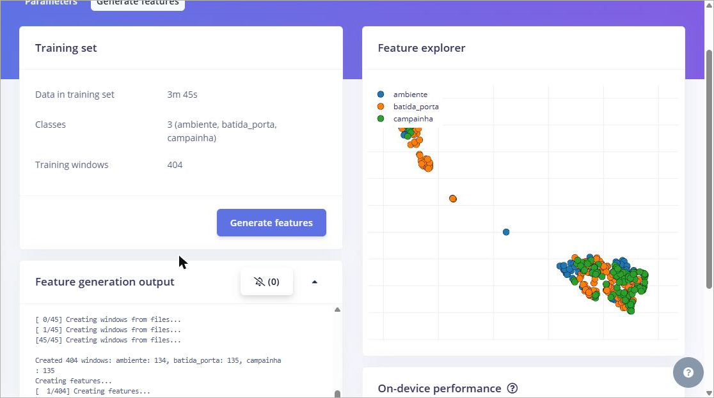
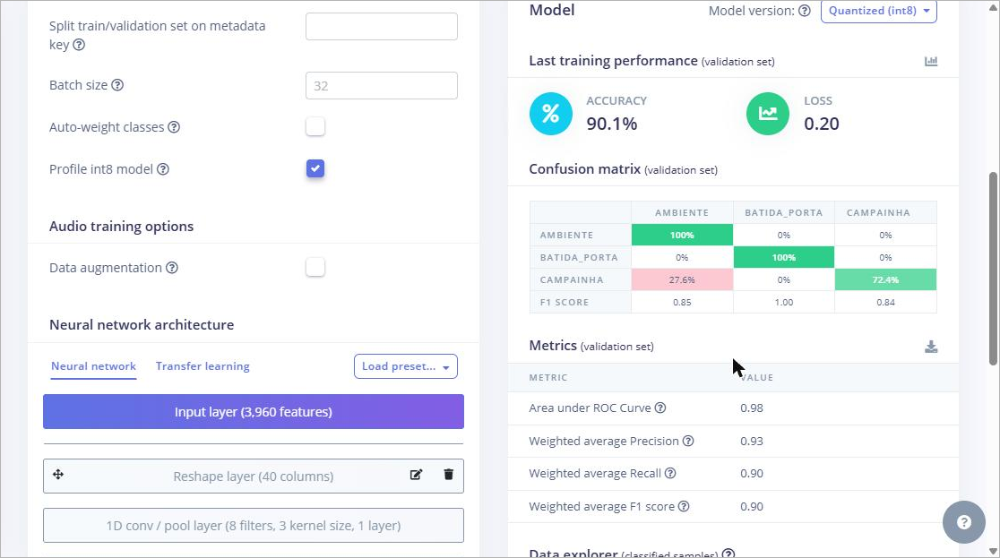
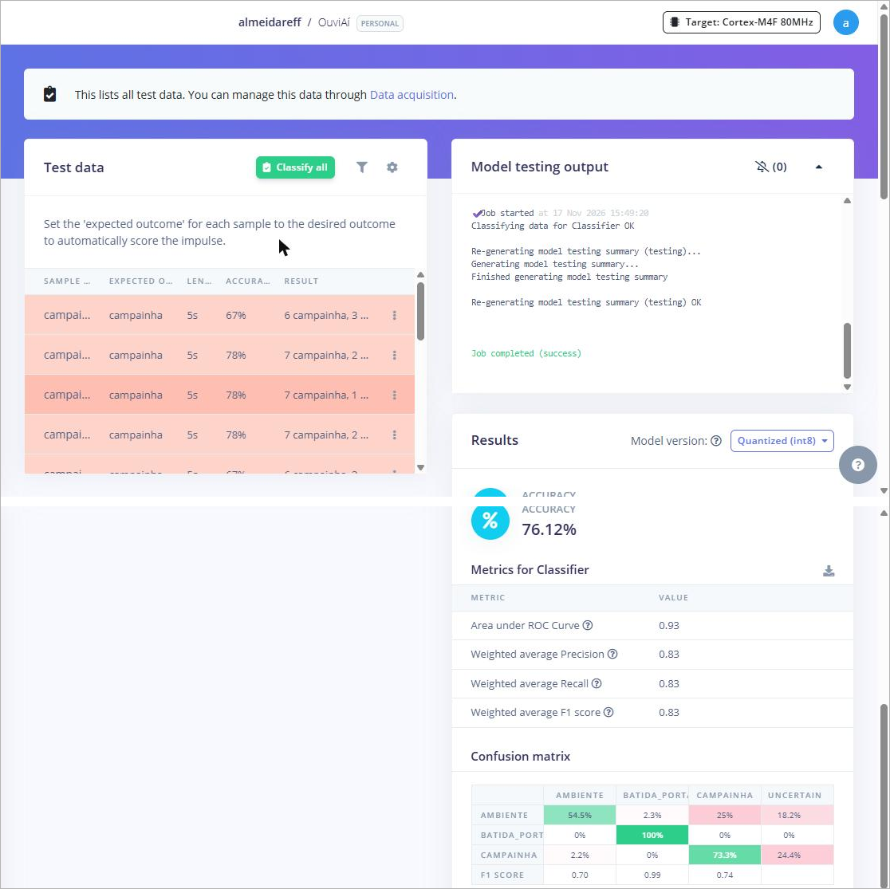

```{=openxml}
<w:p><w:r><w:br w:type="page"/></w:r></w:p>
```

# 1. Problema, público beneficiado e ODS

Pessoas surdas ou com deficiência auditiva não ouvem a campainha nem batidas na porta. As soluções prontas (campainhas com luz, relógios vibratórios) exigem instalação ou custam caro. O OuviAí usa o celular que a pessoa já tem: o microfone escuta, um modelo pequeno roda no próprio aparelho e a tela mostra qual som aconteceu.

**Público beneficiado:** pessoas surdas ou com perda auditiva que moram sozinhas ou passam parte do dia sozinhas em casa.

**ODS 10 (Redução das desigualdades), meta 10.2:** inclusão de pessoas com deficiência usando tecnologia de baixo custo. **ODS 11 (Cidades e comunidades sustentáveis):** moradias e cidades acessíveis.

**Relação com o Zela.** O Zela, a solução CitizenTech deste projeto, trata acessibilidade como requisito (alto contraste, leitura em voz alta, assistente por voz). O OuviAí leva a mesma preocupação para dentro de casa. Os dois não trocam dados: o OuviAí roda isolado no celular.

# 2. Arquitetura

{width=100%}

| Item | Descrição |
|---|---|
| Captura | Microfone do celular, pelo navegador, conectado ao Edge Impulse |
| Processamento | Bloco Audio (MFE): energia em bandas de frequência na escala Mel |
| Modelo | Rede neural convolucional (CNN) treinada no Edge Impulse, projeto privado "almeidareff / OuviAí" |
| Saída | Classe prevista e probabilidade, mostradas na tela do celular (Deployment > Run this model) |
| Origem dos áudios | Gravados por mim em 17/11/2026, entre 12h17 e 12h30, com o meu celular conectado ao Edge Impulse pelo navegador (Data acquisition) |
| Distribuição | 20 gravações de 5 s por classe: 15 em Training e 5 em Test, sem repetir arquivo entre os conjuntos |

# 3. Coleta e tratamento dos dados

| Classe | O que foi gravado | Training | Test |
|------------|----------------------------------------------------|---------|------|
| campainha | Toques de campainha, com intervalos de silêncio entre os toques | 15 | 5 |
| batida_porta | Sequências de batidas na porta | 15 | 5 |
| ambiente | Sons da casa sem campainha nem batida: 15 gravações com som de fundo e 5 quase silenciosas (volume médio abaixo de −45 dBFS) | 15 | 5 |

- **Padronização:** 16 kHz, mono, 5 s por gravação (duas de ambiente ficaram com 4,95 s). O próprio Edge Impulse gravou no formato pedido; nenhuma conversão foi necessária.
- **Divisão Training/Test:** a divisão automática do Edge Impulse (80/20) deixou ambiente com 17 e 3. Movi ambiente_17 e ambiente_18, gravadas no meio da sessão, para Test, e o conjunto ficou com 15 e 5 em cada classe (45 e 15 no total). Os arquivos foram renomeados para classe_01 a classe_15 (Training) e classe_16 a classe_20 (Test), na ordem de gravação, para que os nomes do relatório, da planilha e do Edge Impulse sejam os mesmos.
- **Conferência dos rótulos:** conferi a forma de onda e a energia das 60 gravações (aba Gravacoes da planilha). Todas as de campainha e de batida mostram o evento; nenhuma está vazia ou duplicada (os 60 arquivos têm conteúdos diferentes). Duas gravações de ambiente tinham um pico alto na forma de onda, e eu as ouvi: ambiente_11 tem o ruído de um avião passando, um som de fundo válido para ambiente; ambiente_06 tem uma batida, ou seja, o rótulo está errado. Essa conferência foi feita depois do treino e do teste ao vivo, então ambiente_06 continua no Training deste modelo. O efeito esperado é pequeno (1 das 15 gravações de ambiente do treino) e vai no sentido contrário dos erros observados: ela ensina o modelo a chamar uma batida de ambiente, enquanto os erros do Test e do teste ao vivo foram ambiente virar campainha ou batida. A correção é trocá-la por uma gravação nova de ambiente, treinar de novo e repetir os testes.
- **Observação técnica:** o navegador do celular zera o sinal nos trechos silenciosos (supressão de ruído): de 7% a 98% das amostras de cada gravação são zero. Por isso, cerca de 1 em cada 6 janelas de 1 s das gravações de campainha é silêncio completo (31 de 180), embora tenha o rótulo campainha. Esse detalhe aparece nos resultados (seções 4 e 5).
- **Privacidade:** nenhuma gravação tem conversa identificável.

{width=95%}

# 4. Modelo de IA: MFE, CNN e treinamento

| Parâmetro | Valor usado |
|---|---|
| Janela e passo (Create impulse) | 1.000 ms e 500 ms, 16.000 Hz, zero-pad ligado: 404 janelas de Training (134 de ambiente, 135 de batida e 135 de campainha) |
| MFE: frame length / frame stride / filtros / FFT | 0,02 s / 0,01 s / 40 / 256; frequência de 0 a 8.000 Hz; noise floor de −52 dB; 3.960 valores por janela |
| Arquitetura da CNN | Reshape (40 colunas) → convolução 1D com 8 filtros (kernel 3) e pooling → dropout 0,25 → convolução 1D com 16 filtros (kernel 3) e pooling → dropout 0,25 → flatten → saída com 3 classes |
| Ciclos de treino / taxa de aprendizado | 100 / 0,005 (lote de 32; 20% das janelas de Training separadas para validação) |
| Data augmentation | Não |
| Confiança mínima para aceitar uma classe | 0,6 (abaixo disso a janela fica como "incerto") |

**Por que MFE e CNN.** O MFE transforma o áudio num espectrograma na escala Mel, próxima da forma como o ouvido percebe as frequências, e costuma funcionar melhor que o MFCC para sons que não são fala. A CNN trata esse espectrograma como uma imagem e aprende os padrões de cada som. A janela de 1 s cobre uma campainha ou uma batida inteira. Mantive os valores padrão do bloco MFE e da rede para ter uma linha de base reproduzível; as mudanças que valeriam a pena estão na seção 7.

{width=85%}

{width=85%}

{width=85%}

**Validação do treinamento** (20% das janelas de Training, separadas pelo Edge Impulse; modelo quantizado int8, o mesmo que vai para o celular):

| Medida | Valor |
|---|---|
| Acurácia de validação | 90,1% |
| Perda (loss) | 0,20 |
| F1 por classe (ambiente / batida_porta / campainha) | 0,85 / 1,00 / 0,84 |
| Matriz de confusão | ambiente 100% certo; batida_porta 100% certo; campainha 72,4% certo e 27,6% previsto como ambiente |
| Desempenho estimado num Cortex-M4F de 80 MHz | MFE em 150 ms; rede em 8 ms, com 14,7 KB de RAM e 40,9 KB de flash |

A versão float32 teve a mesma acurácia (90,1%, loss 0,19). O erro concentrado em campainha prevista como ambiente bate com a observação da seção 3: as janelas silenciosas entre um toque e outro têm rótulo campainha, mas soam como ambiente.

{width=85%}

# 5. Teste com arquivos inéditos (Model testing > Classify all)

Os 15 arquivos de Test (5 por classe) não foram usados no treino. O Edge Impulse classifica cada janela de 1 s (9 por arquivo) e informa quantas janelas caíram em cada classe. Para ter uma resposta por arquivo, considerei a classe com mais janelas; "incerto" conta como resposta, e empate conta como incerto. Modelo quantizado (int8).

| Arquivo | Classe real | Janelas (ambiente / batida / campainha / incerto) | Classe prevista | Acertou? |
|-----------------|--------------|--------------------------|------------------|----------|
| campainha_16 | campainha | 0 / 0 / 6 / 3 | campainha | sim |
| campainha_17 | campainha | 0 / 0 / 7 / 2 | campainha | sim |
| campainha_18 | campainha | 1 / 0 / 7 / 1 | campainha | sim |
| campainha_19 | campainha | 0 / 0 / 7 / 2 | campainha | sim |
| campainha_20 | campainha | 0 / 0 / 6 / 3 | campainha | sim |
| batida_porta_16 | batida_porta | 0 / 9 / 0 / 0 | batida_porta | sim |
| batida_porta_17 | batida_porta | 0 / 9 / 0 / 0 | batida_porta | sim |
| batida_porta_18 | batida_porta | 0 / 9 / 0 / 0 | batida_porta | sim |
| batida_porta_19 | batida_porta | 0 / 9 / 0 / 0 | batida_porta | sim |
| batida_porta_20 | batida_porta | 0 / 9 / 0 / 0 | batida_porta | sim |
| ambiente_16 | ambiente | 3 / 1 / 5 / 0 | campainha | não |
| ambiente_17 | ambiente | 5 / 0 / 0 / 4 | ambiente | sim |
| ambiente_18 | ambiente | 4 / 0 / 4 / 0 (8 janelas) | incerto (empate) | não |
| ambiente_19 | ambiente | 3 / 0 / 2 / 4 | incerto | não |
| ambiente_20 | ambiente | 9 / 0 / 0 / 0 | ambiente | sim |

**Matriz de confusão do Test, por arquivo:**

| | campainha (prevista) | batida_porta (prevista) | ambiente (prevista) | incerto |
|---|---|---|---|---|
| campainha (real) | 5 | 0 | 0 | 0 |
| batida_porta (real) | 0 | 5 | 0 | 0 |
| ambiente (real) | 1 | 0 | 2 | 2 |

**Matriz de confusão do Test, por janela** (a que o Edge Impulse mostra):

| | campainha (prevista) | batida_porta (prevista) | ambiente (prevista) | incerto |
|---|---|---|---|---|
| campainha (real, 45 janelas) | 73,3% | 0% | 2,2% | 24,4% |
| batida_porta (real, 45 janelas) | 0% | 100% | 0% | 0% |
| ambiente (real, 44 janelas) | 25,0% | 2,3% | 54,5% | 18,2% |

Acertos no Test: **12 de 15 arquivos (80%)**; por janela, 102 de 134 (**76,1%**, a acurácia informada pelo Edge Impulse). Na versão float32, 77,6% por janela e 13 de 15 arquivos (ambiente_19 passa a ser ambiente).

**Discussão dos erros.**

- **Batida na porta** acertou todas as 45 janelas: é um som curto, forte e com energia em muitas frequências, diferente das outras duas classes.
- **Campainha** acertou os 5 arquivos, mas 11 das 45 janelas ficaram incertas e 1 foi para ambiente. São as janelas entre um toque e outro, em que o celular gravou silêncio: o mesmo erro da validação.
- **Ambiente** é o ponto fraco: 11 das 44 janelas (25%) foram classificadas como campainha. Os erros se concentram em três arquivos: ambiente_16 (5 de 9 janelas como campainha), ambiente_18 (4 de 8; é a gravação de ambiente com maior volume médio, −24 dBFS) e ambiente_19 (2 janelas como campainha e 4 incertas). Duas causas prováveis: o treino tem janelas de silêncio e de ruído baixo com rótulo campainha, o que ensina o modelo a aceitar "pouco som" como campainha; e há poucos exemplos de sons de fundo variados (15 gravações de ambiente para toda a casa).
- **Consequência para o usuário:** no uso real, cada janela de ambiente prevista como campainha seria um aviso falso. Um aplicativo deveria exigir duas janelas seguidas acima do limiar antes de avisar (seção 8).
- **Validação otimista.** A validação (90,1%) é sorteada por janela, e não por gravação: janelas da mesma gravação de 5 s, que se sobrepõem em meio segundo, caem no treino e na validação. No Test, os arquivos são inteiros e inéditos, por isso o resultado (76,1%) é menor e mais próximo do uso real.

Não ajustei o modelo depois de ver o Test: ajustar olhando o Test transformaria esses arquivos em dados de treino indiretos e deixaria o resultado otimista. As melhorias estão listadas na seção 7.

{width=85%}

# 6. Validação em tempo real no celular (Deployment > Run this model)

Em 18/11/2026, abri o modelo no navegador do celular pelo QR Code, autorizei o microfone e fiz 5 tentativas por classe. O celular ficou em cima da mesa, a 50 cm da porta. Em cada tentativa anotei a classe que apareceu na tela e a confiança mostrada; nas tentativas de ambiente, contei como falso positivo quando a tela mostrou campainha ou batida sem que o som tivesse acontecido.

| # | Som produzido | Classe prevista na tela (confiança) | Acertou? |
|---|---|---|---|
| 1 | toque da campainha | campainha (1,00) | sim |
| 2 | toque da campainha | campainha (1,00) | sim |
| 3 | toque da campainha | campainha (1,00) | sim |
| 4 | toque da campainha | campainha (1,00) | sim |
| 5 | toque da campainha | campainha (1,00) | sim |
| 6 | batida na porta | batida_porta (1,00) | sim |
| 7 | batida na porta | batida_porta (1,00) | sim |
| 8 | batida na porta | batida_porta (1,00) | sim |
| 9 | batida na porta | batida_porta (1,00) | sim |
| 10 | batida na porta | batida_porta (1,00) | sim |
| 11 | som da casa, com reforma no vizinho ao fundo | oscilou entre as três classes; ambiente abaixo de 0,10 | não (falso positivo) |
| 12 | som da casa, com reforma no vizinho ao fundo | oscilou entre as três classes; ambiente abaixo de 0,10 | não (falso positivo) |
| 13 | som da casa, com reforma no vizinho ao fundo | oscilou entre as três classes; ambiente abaixo de 0,10 | não (falso positivo) |
| 14 | som da casa, com reforma no vizinho ao fundo | oscilou entre as três classes; ambiente abaixo de 0,10 | não (falso positivo) |
| 15 | som da casa, com reforma no vizinho ao fundo | oscilou entre as três classes; ambiente abaixo de 0,10 | não (falso positivo) |

- **Percentual de acertos ao vivo:** 10 de 15 = **66,7%** (campainha 5 de 5, batida na porta 5 de 5, ambiente 0 de 5)
- **Falsos positivos na classe ambiente** (o modelo mostrou campainha ou batida sem o som ter acontecido): **5 de 5**

**O que aconteceu em ambiente.** Nas cinco tentativas, a tela alternou entre as três classes e a probabilidade de ambiente ficou abaixo de 0,10; na maior parte do tempo apareciam campainha ou batida. No dia do teste, o vizinho estava em obra: marteladas e batidas de reforma são impulsos fortes, parecidos com uma batida na porta, e nenhum som desse tipo estava nas gravações de ambiente. A confusão com campainha repete, mais forte, o erro já visto no Test (25% das janelas de ambiente previstas como campainha).

**Evidência:** vídeo do teste ao vivo no celular, com o modelo aberto no navegador e as classes mudando: <https://youtube.com/shorts/BKm9vIrK8n4>.

# 7. Comparação das três avaliações e limitações

| Avaliação | O que mede | Resultado |
|---|---|---|
| (1) Validação do treinamento | 20% das janelas de Training, separadas pelo Edge Impulse | 90,1% |
| (2) Teste com WAVs inéditos | 15 arquivos de Test nunca usados no treino | 76,1% por janela; 12 de 15 arquivos (80%) |
| (3) Tempo real no celular | 15 tentativas ao vivo, com eco, distância e ruídos do momento | 66,7% (10 de 15); 5 falsos positivos em 5 tentativas de ambiente |

A probabilidade que aparece na tela do celular é a confiança do modelo naquela janela de áudio, e não a acurácia do modelo: a acurácia é a proporção de acertos nas tentativas.

**Limitações.** A queda de 90,1% na validação para 76,1% no Test vem de dois fatores: a validação mistura janelas da mesma gravação no treino e na validação, e o Test traz gravações inteiras que o modelo nunca viu. Ao vivo, o resultado caiu para 66,7%, e a queda veio inteira de ambiente: campainha e batida acertaram as 10 tentativas com confiança de 1,00, mas a 50 cm da porta, perto das condições das gravações; ambiente errou as 5, porque a obra no vizinho trouxe sons que o modelo nunca viu e que se parecem com batidas. As três avaliações medem coisas diferentes: a validação mede janelas parecidas com as do treino, o Test mede gravações inéditas feitas no mesmo dia e lugar, e o teste ao vivo mede o modelo no ambiente real, com os ruídos do momento. A confiança de 1,00 na tela não quer dizer que o modelo acerta sempre: no mesmo teste, ele mostrou campainha e batida com o mesmo tipo de confiança em momentos em que nada disso aconteceu. O erro que mais importa é ambiente previsto como campainha ou batida (25% das janelas de ambiente no Test e 5 de 5 tentativas ao vivo), porque vira aviso falso: do jeito que está, o modelo não serve para uso diário. Além disso: o modelo conhece só a campainha e a porta gravadas; uma gravação de ambiente do treino (ambiente_06) contém uma batida; são poucas gravações (60, todas numa única sessão de cerca de 13 minutos); o navegador zera os trechos silenciosos, o que deixa janelas sem som com o rótulo de campainha; o celular precisa ficar com a tela ligada e o navegador aberto. Para o usuário, perder uma campainha (falso negativo) é pior que um aviso a mais, mas avisos falsos frequentes fazem a pessoa parar de confiar.

**O que melhoraria o modelo** (não aplicado, para não ajustar o modelo olhando o Test): recortar os toques de campainha e as batidas em amostras de 1 s (Split sample) para tirar o silêncio dos rótulos de evento; gravar mais ambiente, com TV, música, ventilador, rua e obras (marteladas, furadeira) em volumes diferentes; ligar o data augmentation; e separar treino e validação por gravação, para a validação não ficar otimista.

O protótipo é educacional e não substitui sistemas de segurança nem alertas de emergência.

# 8. Evolução: alertas acessíveis

Hoje o resultado aparece só na tela aberta pelo Edge Impulse. Para virar uma ajuda de uso diário, o próximo passo é exportar o modelo (Deployment > Android ou WebAssembly) e criar um aplicativo que, quando a confiança passar de um limiar por duas janelas seguidas, vibre com um padrão diferente por classe (curto para campainha, longo para batida), acenda a lanterna e envie uma notificação para o relógio inteligente, se houver. Exigir duas janelas seguidas reduz os avisos falsos isolados vistos no Test; os do teste ao vivo, que se repetiram por toda a tentativa, só diminuem com mais gravações de ambiente. O aplicativo rodaria em segundo plano, o que um modelo pequeno como este permite: a rede ocupa cerca de 41 KB e responde em 8 ms mesmo num microcontrolador de 80 MHz.

**Evolução ligada ao Zela.** Acrescentar a classe **sirene de alerta** (sirenes da Defesa Civil em áreas de risco de alagamento e deslizamento). Quem não ouve a sirene receberia o alerta por vibração e luz, e o aplicativo abriria as orientações de segurança para chuvas que já estão na base do assistente do Zela.

# 9. Privacidade e segurança

O áudio é processado no celular e não é enviado para a internet durante o uso. As gravações de treino ficaram no meu projeto privado do Edge Impulse e não têm conversas identificáveis. A chave de API do projeto (que aparece dentro dos QR Codes do Edge Impulse) não foi colocada no relatório nem no repositório. Num produto real, o aplicativo precisaria pedir a permissão de microfone explicando o motivo e não gravar nada em disco.
